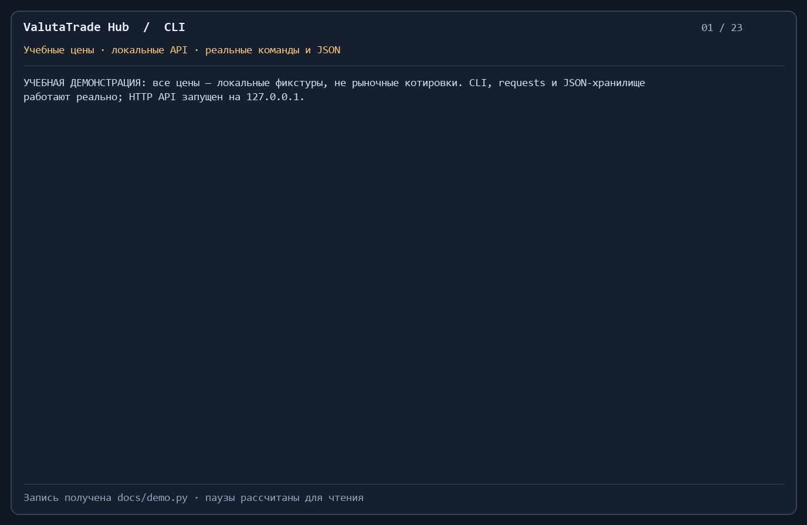

# ValutaTrade Hub

Итоговый проект «Платформа для отслеживания и симуляции торговли валютами».
**Кислицын Дмитрий Геннадьевич, М26-555**.
Имя: `finalproject_kislitsyn_m26_555`.

Консольное приложение регистрирует пользователей, хранит виртуальные кошельки
и совершает сделки за USD. Parser Service получает курсы CoinGecko и
ExchangeRate-API, ведёт историю и обновляет локальный кэш. Недоступные курсы
не заменяются выдуманными значениями.

## Установка

Нужны [uv](https://docs.astral.sh/uv/getting-started/installation/) и Python
3.12 или новее. uv может установить подходящий Python самостоятельно.
Из каталога проекта:

```powershell
uv sync --frozen
uv run project
```

Авторизация действует внутри интерактивного процесса до `logout`/`exit`.
Отдельные вызовы `uv run project login ...` и `uv run project buy ...` не делят
сессию. Однократный запуск подходит для публичных команд, например
`uv run project show-rates --top 2`.

Публичный CoinGecko работает без ключа. Для фиатных валют получите свой ключ
[ExchangeRate-API](https://www.exchangerate-api.com/) и задайте окружение:

```powershell
# PowerShell
$env:EXCHANGERATE_API_KEY = "ваш-ключ"
uv run project
```

```bash
# Linux/macOS
export EXCHANGERATE_API_KEY="ваш-ключ"
uv run project
```

Опционально поддерживается `COINGECKO_API_KEY` для CoinGecko Demo API.
`.env.example` описывает переменные; автоматического чтения `.env` нет.
Ключи не выводятся в ошибки, repr конфигурации или журналы.

## Пользовательский сценарий

Регистрация создаёт **пустой портфель**. Дополнительная команда `deposit`
пополняет виртуальный USD-кошелёк для учебной симуляции. Покупка списывает
USD, продажа возвращает USD. Количество `amount` указано в единицах валюты,
стоимость — `amount * rate` в USD.

```text
update-rates
register --username alice --password demo1234
login --username alice --password demo1234
show-portfolio
deposit --amount 10000
buy --currency BTC --amount 0.01
y
sell --currency BTC --amount 0.005 --yes
show-portfolio --base USD
get-rate --from USD --to BTC
show-rates --top 2
logout
exit
```

Сделка требует входа и подтверждения. `--yes` служит явным подтверждением;
иной ответ отменяет действие. Недостаток средств не меняет файл и не создаёт
кошелёк. Нулевые, отрицательные и бесконечные суммы, NaN и bool отклоняются.
Коды вводятся заглавными: `USD`, `EUR`, `GBP`, `RUB`, `BTC`, `ETH`, `SOL`.
Имена/пароли с пробелами заключаются в кавычки. Имя обрезается по краям,
проверяется на уникальность с сохранением регистра. Пароль — минимум четыре
символа; хранится SHA-256 с индивидуальной солью по учебному заданию.

| Команда | Аргументы | Результат |
|---|---|---|
| `register`, `login` | `--username`, `--password` | Регистрация / вход |
| `deposit` | `--amount`, опционально `--currency USD` | Пополнение виртуальных USD |
| `show-portfolio` | опционально `--base USD` | Балансы и общая оценка |
| `buy`, `sell` | `--currency`, `--amount`, опционально `--yes` | Сделка за USD |
| `get-rate` | `--from`, `--to` | Прямой/обратный курс, обновление при старом кэше |
| `update-rates` | опционально `--source coingecko` или `exchangerate` | Опрос источников |
| `show-rates` | опционально `--currency`, `--top`, `--base` | Фильтр и показ кэша |
| `logout`, `help`, `exit` | без аргументов | Выход из аккаунта, справка, закрытие |

`show-rates` не обращается к сети, помечает старые значения. `--top N` выбирает
криптовалюты по убыванию цены; `--currency RUB` фильтрует RUB, `--base EUR`
пересчитывает цены в EUR. При отсутствии свежего курса `show-portfolio`
сообщает о невозможности полной оценки. Ошибка команды не закрывает сессию.

## Структура

```text
data/                         # users, portfolios, rates, exchange_rates JSON
valutatrade_hub/
  core/
    models.py                 # User, Wallet, Portfolio
    currencies.py             # Currency ABC, FiatCurrency, CryptoCurrency
    exceptions.py             # ошибки предметной области
    usecases.py               # операции кошелька и получения курсов
    utils.py                  # UTC, валидация, замыкание кэша
  infra/
    settings.py               # SettingsLoader Singleton
    database.py               # DatabaseManager Singleton, атомарный JSON
  parser_service/
    config.py                 # ParserConfig dataclass
    api_clients.py            # BaseApiClient и два источника
    storage.py                # история и последние курсы
    updater.py                # RatesUpdater с частичным успехом
    scheduler.py              # отдельный периодический запуск
  cli/interface.py            # argparse, сессия, PrettyTable
  decorators.py               # @log_action и @confirm_action
  logging_config.py           # журналы с ротацией
main.py                       # устанавливаемая команда project
tests/, docs/, pyproject.toml, uv.lock, Makefile, README.md
```

CLI вызывает usecases, модели валидируют состояние, инфраструктура сохраняет
его. Core читает `rates.json`; HTTP выполняют API-клиенты парсера. Импорт
модуля не запускает обновления или фоновые задачи.

## Настройки и данные

SettingsLoader читает `[tool.valutatrade]` из `pyproject.toml` в текущем
каталоге, затем окружение. `VALUTATRADE_CONFIG` задаёт иной TOML. В установленном
wheel без исходного TOML работают встроенные значения и окружение.

| Параметр | По умолчанию | Переменная |
|---|---|---|
| Данные | `data` в текущем каталоге | `VALUTATRADE_DATA_DIR` |
| Журналы | `logs` в текущем каталоге | `VALUTATRADE_LOG_DIR` |
| TTL | 86400 секунд | `VALUTATRADE_RATES_TTL_SECONDS` |
| Таймаут HTTP | 10 секунд | `VALUTATRADE_REQUEST_TIMEOUT` |
| Валюта расчётов | USD | `VALUTATRADE_BASE_CURRENCY` (допускается USD) |

Parser и Core должны использовать один каталог данных. Файлы не привязаны
к месту установки Python-пакета. Поставляемые данные пустые.
`users.json` содержит user_id, username, hashed_password, salt, registration_date.
`portfolios.json` содержит user_id и wallets с балансами.
Итоговый формат кэша (ниже пример, а не рыночная котировка):

```json
{
  "pairs": {
    "EUR_USD": {"rate": 1.1, "updated_at": "2026-10-08T09:00:00Z", "source": "ExchangeRate-API"}
  },
  "last_refresh": "2026-10-08T09:00:30Z"
}
```

`exchange_rates.json` — список измерений с уникальным ID
`FROM_TO_<UTC-время>`, from_currency, to_currency, rate, timestamp, source,
meta (raw_id, request_ms, status_code, etag). Повторный ID не добавляется;
в кэш попадает только более новое время источника.

Каждый JSON пишется во временный файл рядом с исходным, синхронизируется
и заменяется `os.replace`. При ошибке записи регистрации уже изменённый
файл восстанавливается. Повреждённый JSON не очищается автоматически.
Блокировка действует внутри одного процесса. Для учебного хранилища
запускайте одного писателя каждого файла: межпроцессной транзакции и защиты
от отключения питания между двумя заменами здесь нет.

`logs/actions.log` и `logs/parser.log` ротируются: 1 МБ и три копии.
@log_action фиксирует действие, user_id/username, валюту, сумму, курс, балансы
до/после, OK/ERROR, тип и текст ошибки. Пароли и соли не логируются.
Исключения передаются вызывающему CLI после записи в журнал.

## Уточнения к методичке

1. Использован итоговый формат раздела 4 (`pairs`, `last_refresh`), вместо
   старого плоского примера раздела 2.
2. [Standard ExchangeRate-API](https://www.exchangerate-api.com/docs/standard-requests)
   возвращает `conversion_rates`, а не `rates`. При базе USD значение EUR
   означает EUR за USD, поэтому `EUR_USD = 1 / conversion_rates["EUR"]`.
   0.927 превращается примерно в 1.07875 USD за EUR.
3. [CoinGecko Simple Price](https://docs.coingecko.com/reference/simple-price)
   использует ID монет и `include_last_updated_at=true`. Время криптоисточника
   берётся из last_updated_at, фиатного — из time_last_update_unix.
4. updated_at — время источника, last_refresh — успешная проверка. Повторный
   запрос не освежает старое измерение. TTL 86400 учитывает суточный фиатный
   источник; можно задать 300. Кросс-курс наследует самое старое время частей.
5. Покупка списывает USD по прямому требованию к Portfolio. Для пустого
   портфеля регистрации добавлено явное виртуальное пополнение deposit.
6. Отказ одного источника сохраняет корректные данные остальных и выдаёт
   предупреждение. Полный отказ сохраняет прежние файлы. HTTP-ошибки не
   содержат URL с ключом или тела ответа провайдера.

## Отдельный парсер

```powershell
# Один опрос
uv run parser --interval 3600 --iterations 1
# Опрос каждый час до Ctrl+C
uv run parser --interval 3600
```

Расписание ОС автоматически не создаётся. Криптовалюты отдельно:
`uv run project update-rates --source coingecko`. Без фиатного ключа второй
источник выдаёт предупреждение, а доступный первый продолжает работу.

## Проверки и сборка

```powershell
uv run ruff check .
uv run ruff format --check .
uv run python -m unittest discover -s tests -v
uv build
```

64 теста проверяют модели, настоящие изолированные JSON-файлы, полный CLI,
ошибки и сохранность балансов, TTL, обратные/кросс-курсы, неверные API-ответы,
историю, более новое измерение и частичный отказ. HTTP в unittest изолирован.

Makefile: `install`, `run`, `lint`, `test`, `build`, `package-install`.
Без GNU Make в Windows выполняйте соответствующие uv-команды выше напрямую.
`package-install` собирает wheel и устанавливает его в `.venv` без индекса
и повторной установки уже синхронизированных зависимостей.

Hatchling сохраняет корневую структуру преподавателя:
`only-include = ["valutatrade_hub", "main.py"]`. Команда project = main:main.
Wheel содержит пакет и main, без data/logs/.env. Проверяйте wheel вне исходников
в отдельном окружении, чтобы editable-установка не скрыла пропущенный модуль:

```powershell
uv venv --python 3.12 ..\clean-env
uv pip install --python ..\clean-env\Scripts\python.exe dist\finalproject_kislitsyn_m26_555-1.0.0-py3-none-any.whl
Set-Location ..
.\clean-env\Scripts\project.exe help
```

## Демонстрация



[Asciicast](docs/demo.cast) · [Текст вывода](docs/demo-transcript.txt) ·
[События и балансы](docs/demo-events.json) · [Скрипт](docs/demo.py)

```powershell
uv run python docs/demo.py
```

21 команда исполняется настоящими CLI, usecases и JSON-хранилищем.
requests делает два HTTP-запроса к локальному учебному серверу с форматами
двух API. Данные изолированы во временном каталоге, цены явно обозначены
фикстурами. Проверяются шесть курсов, подтверждение/отмена, сделки, оценка
в USD/EUR, фильтры, ошибки и запрет сделки после logout. Итог: **7890 USD,
0.04 BTC и 100 EUR**; отменённая покупка не создаёт ETH-кошелёк.
Паузы рассчитаны для чтения, а не измеряют скорость ручного набора.

## Фактическая проверка

Windows, Python 3.12.13: 64 unittest, Ruff и форматирование прошли.
Wheel установлен в чистое окружение; project запущен вне исходников,
main и пакет импортированы из site-packages. Пустой кэш даёт понятную ошибку
с кодом 1, справка project/parser — код 0.

08.10.2026 реальный публичный CoinGecko вернул три курса в отдельный проверочный
каталог; top-фильтр и USD→BTC работают. Ключа ExchangeRate-API в окружении нет:
живой фиатный запрос не проверен. Проверены контракт, инверсия, ошибки и локальный
HTTP-сценарий. Linux и удалённый CI пока не запускались.

Git-история сохранена локально. Новый GitHub-репозиторий, загрузка на
asciinema.org и отправка в форму Практикума пока не выполнялись.
